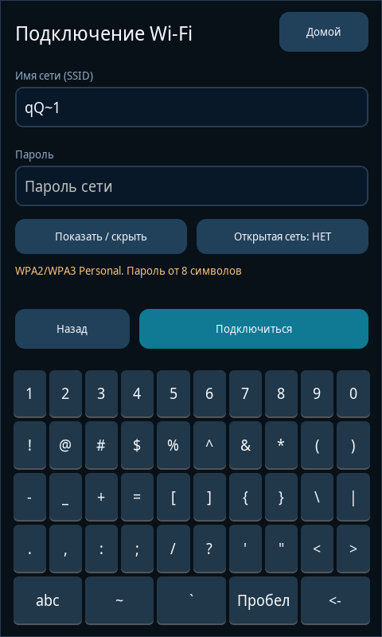
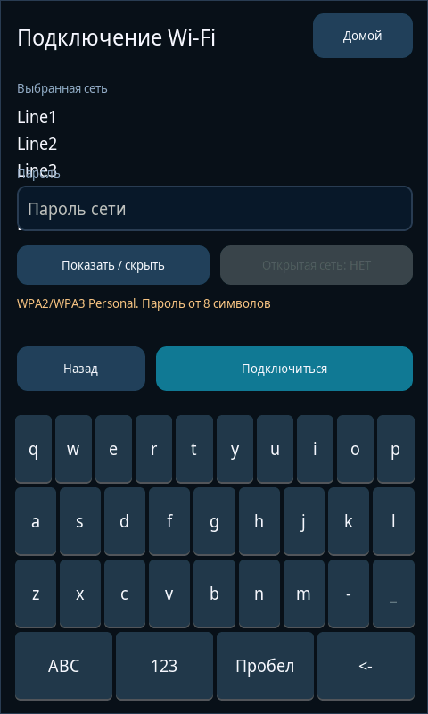
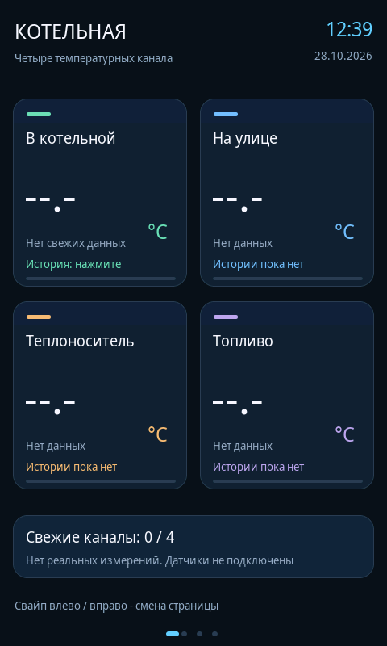

# Независимая проверка проекта «Панель котельной»

Дата: **28 октября 2026 года**. Репозиторий: [DeadSoulf/boiler_room](https://github.com/DeadSoulf/boiler_room).

Проверен точный снимок **[`b700ef6f837f5fc1dbd0bad91a569159123c3851`](https://github.com/DeadSoulf/boiler_room/tree/b700ef6f837f5fc1dbd0bad91a569159123c3851)**, дерево `dbe41735d0b81424861c3c1976985bf5aed94b9e`. Все выводы ниже относятся к этому снимку. Документы и дополнительные проверки аудита не изменяют прошивку или установщик.

## Вердикт

**Требует исправлений перед следующим функциональным выпуском.** Точная версия успешно собирается в GitHub Actions, штатные проверки проходят. Дополнительные проверки обнаружили **пять существенных дефектов и три небольших недостатка**. Успех сборки не подтверждает отсутствие этих ошибок и не заменяет испытание панели.

| ID | Приоритет | Подтверждённое замечание | Доказательство |
|---|---|---|---|
| A01 | P2 | Переключение экранной клавиатуры на цифры вводит лишний `~`; возврат «abc» может оставить верхний регистр | Настоящие pointer-события LVGL 8.3.11 |
| A02 | P2 | При отказе смены Wi-Fi сохраняются параметры новой сети, хотя соединение осталось со старой; сообщение об отключении тоже может быть ложным | Неизменённый радиокод, моделирование допустимых отказов SDK |
| A03 | P2 | Постоянная ошибка записи повреждает манифест резервной копии и блокирует штатное восстановление | Реальный `EFBIG` в изолированном временном проекте |
| A04 | P2 | BLE сообщает о завершении поиска, который не запустился | Неизменённый радиокод и точная обёртка Arduino-ESP32 3.3.6 |
| A05 | P2 | Preflight принимает несовместимые переопределения MCU, варианта чипа и LVGL | Три отрицательных случая на штатном v0.3.1 fixture |
| A06 | P3 | Переводы строк в имени SSID перекрывают подпись поля пароля | Рендер LVGL, геометрия и изображение |
| A07 | P3 | После устаревания полученного отсчёта общий блок заявляет, что реальных измерений не было | Модель измерений и настоящий UI |
| A08 | P3 | В проверенном ZIP прошивки отсутствуют имеющиеся в репозитории тексты лицензий компонентов | Проверка состава артефакта GitHub Actions |

P2 здесь означает воспроизводимую функциональную ошибку или отказ восстановления, который следует устранить до следующего выпуска. P3 — ограниченный недостаток отображения либо комплектации. Категории не являются оценкой CVSS; подтверждённых критических уязвимостей этот отчёт не заявляет.

## Кто и что проверял

По просьбе владельца проверены доступные в сессии определения агентов и каталоги навыков. Отдельных сохранённых профилей специализированных агентов не обнаружено; найден и применён пользовательский навык **«Проверяющий» (`review-chatgpt-work`)**. Затем работа распределена между тремя независимыми ролями, а ведущий проверяющий сопоставил доказательства и повторил ключевые воспроизведения.

| Роль | Область |
|---|---|
| `review_boiler_design` | LVGL, русский интерфейс, навигация, экранная клавиатура, свежесть/история, таймер и пробуждение |
| `audit_radio` | Wi-Fi/BLE, NVS, очередь команд, отмена, секреты, соответствие API закреплённого SDK |
| `audit_update_security` | Обновление и откат, совместимость, пути/целостность, CI, артефакты и границы безопасности |
| Ведущий проверяющий | GitHub и точный снимок, сверка исходников и артефактов, штатные тесты, независимый повтор, общий отчёт |

Проверены **75 файлов** снимка, включая исходники, установщик, CI, тесты, fixtures и документацию. Их получение подтверждено Git blob SHA-1 и дополнительными SHA-256: [source-manifest.json](evidence/source-manifest.json). Это не означает построчный аудит каждого байта сгенерированного шрифта или всех исходников внешнего SDK: для шрифта проверялись происхождение, целостность, отображение и комплектация лицензией; для SDK — используемые API и конкретные отказные пути.

### Границы проекта

Проверка опирается на [контракт текущего проекта](https://github.com/DeadSoulf/boiler_room/blob/b700ef6f837f5fc1dbd0bad91a569159123c3851/README_RU.md): GUITION JC4880P443, ESP32-P4 ES v1.3, ESP32-C6, портретный экран 480×800, LVGL 8.3.11. Четыре температурных канала: «В котельной», «На улице», «Теплоноситель», «Топливо». Без источников данных отображается `--.-`; датчики и силовые выходы в этой версии не интегрированы. BLE предназначен только для поиска объявлений.

Не добавлялись требования, пины, датчики или исполнительные механизмы из других проектов. Canva-макет не является реализацией интерфейса и не использован как доказательство работы прошивки.

## A01. Переключение клавиатуры вводит лишний символ

**Код:** [main.cpp:120–149](https://github.com/DeadSoulf/boiler_room/blob/b700ef6f837f5fc1dbd0bad91a569159123c3851/src/main.cpp#L120-L149).

`keyboardEvent()` немедленно заменяет карту `lv_btnmatrix` внутри `LV_EVENT_VALUE_CHANGED`. Палец в этот момент ещё удерживается; под прежними координатами оказывается другая клавиша новой карты. Обработчик получает дополнительное событие и вводит её текст. Соответствующее поведение зависимости видно в [LVGL 8.3.11, lv_btnmatrix.c](https://github.com/lvgl/lvgl/blob/74d0a816a440eea53e030c4f1af842a94f7ce3d3/src/widgets/lv_btnmatrix.c#L456-L494).

Воспроизведение использует фактический `main.cpp`, настоящий LVGL и обычные pointer-нажатия длительностью 60 мс:

1. Открыть ручной ввод SSID.
2. Нажать `q`, затем `ABC`, затем `Q`, затем `123`, затем `1`.
3. Ожидается `qQ1`; получено **`qQ~1`**.
4. Прямое переключение пустого поля из нижнего регистра на `123` также вставляет `~`.
5. Возврат `abc` из символьной раскладки может снова выбрать верхний регистр.

Обработчик общий для полей SSID и пароля. Следствие для пароля — возможная отправка строки с незаметным лишним знаком. Это не установление причины ранее наблюдавшихся проблем конкретной физической панели.



**Почему штатный тест пропустил:** [host.cpp:118](https://github.com/DeadSoulf/boiler_room/blob/b700ef6f837f5fc1dbd0bad91a569159123c3851/tests/host/host.cpp#L118) заполняет поля через `lv_textarea_set_text`, обходя реальный набор по клавишам.

**Исправление и приёмка:** менять карту после завершения нажатия либо настроить события служебных клавиш так, чтобы один жест не обрабатывался новой картой повторно. Проверить оба направления смены раскладки, верхний/нижний регистр и ввод в поле пароля. Каждое нажатие должно давать ровно предусмотренное действие.

## A02. Ложный успех смены или отключения Wi-Fi

**Код:** [panel_radio.cpp:212–252](https://github.com/DeadSoulf/boiler_room/blob/b700ef6f837f5fc1dbd0bad91a569159123c3851/src/panel_radio.cpp#L212-L252), [280–293](https://github.com/DeadSoulf/boiler_room/blob/b700ef6f837f5fc1dbd0bad91a569159123c3851/src/panel_radio.cpp#L280-L293).

Результаты `WiFi.disconnect()` и `WiFi.begin()` игнорируются. Следующая проверка считает достаточными `WL_CONNECTED` и ненулевой IP. При допустимом отказе SDK старое соединение может остаться активным; код тогда принимает его за успех подключения к новой сети и сохраняет новые параметры.

```text
requested_ssid=requested-new-network
actual_ssid=test
credential_writes=1
saved_ssid=requested-new-network
elapsed_ms=0
message=Подключено. Время синхронизируется
```

В отдельном сценарии отключение возвращает отказ, фактическое соединение и UI-флаг `connected` остаются истинными, но текст сообщает: «Wi-Fi отключён. Автоподключение выключено».

Модель отказа опирается на первичные исходники используемого Arduino-ESP32 3.3.6: [WiFiSTA::begin](https://github.com/espressif/arduino-esp32/blob/3.3.6/libraries/WiFi/src/WiFiSTA.cpp#L83-L92), [STA::connect](https://github.com/espressif/arduino-esp32/blob/3.3.6/libraries/WiFi/src/STA.cpp#L363-L423), [STA::disconnect](https://github.com/espressif/arduino-esp32/blob/3.3.6/libraries/WiFi/src/STA.cpp#L527-L558). В проверке изменялись только заглушки API, исходник приложения оставался точным.

При отказе `begin` без старого соединения ложного сохранения нет: приложение ждёт 20 000 мс модельного времени и выдаёт тайм-аут вместо немедленной ошибки запуска. Это связанная неточность диагностики; физические задержки платы здесь не измерялись.

**Исправление и приёмка:** учитывать результаты переходов, проверять, что соединение относится к текущей команде и выбранной сети, и только затем сохранять credentials. При отказе сохранять прежние параметры. Проверить отказ disconnect, немедленный отказ begin, успешную смену сети, отмену и отключение; текст и фактическое состояние должны совпадать.

## A03. Ошибка записи разрушает метаданные отката

**Код:** [apply_update.py:218–258](https://github.com/DeadSoulf/boiler_room/blob/b700ef6f837f5fc1dbd0bad91a569159123c3851/apply_update.py#L218-L258), чтение манифеста [268–286](https://github.com/DeadSoulf/boiler_room/blob/b700ef6f837f5fc1dbd0bad91a569159123c3851/apply_update.py#L268-L286).

Исходники записываются с временным файлом и заменой, но `manifest.json` перезаписывается обычным `write_text()`, который сначала обрезает существующий файл. При устойчивом отказе записи повреждение может затронуть и попытку отката исходников, и сохранение статуса ошибки. Второе исключение также скрывает сформированное сообщение о неполном откате.

В изолированном v0.3.1 fixture после двух успешных замен установлено процессное ограничение `RLIMIT_FSIZE=512`. `SIGXFSZ` обработан так, чтобы реальные записи возвращали `EFBIG/OSError`. Затем ограничение полностью снято и вызван штатный `restore()`.

Получено:

- `main.cpp` и `panel_types.h` остались новыми, четыре других файла плана — старыми;
- старые байты всех исходников в резервной копии сохранились;
- `manifest.json` обрезан до **512 байт**, JSON недействителен;
- после снятия отказа `restore()` всё ещё завершается **`JSONDecodeError`**.

Это обработанная постоянная ошибка I/O, а не отключение питания. Оговорка `power_loss_atomic: false` не устраняет проблему. Заполнение диска `ENOSPC` отдельно не моделировалось; установленный экспериментальный факт относится к `EFBIG`.

**Исправление и приёмка:** сохранять манифест через отдельный временный файл и атомарную замену, сохраняя предыдущий валидный `prepared` при отказе. Первичный манифест должен существовать до изменения исходников. Неудачная запись статуса не должна скрывать первичную ошибку и путь копии. Регрессии: постоянный отказ после двух замен с последующим успешным restore; отказ финальной записи статуса; отказ первоначального манифеста без изменения исходников.

## A04. BLE выдаёт ложное сообщение о завершении поиска

**Код:** [panel_radio.cpp:255–278](https://github.com/DeadSoulf/boiler_room/blob/b700ef6f837f5fc1dbd0bad91a569159123c3851/src/panel_radio.cpp#L255-L278).

Ненулевой результат `BLEScan::start(duration, false)` используется как признак успеха. Однако [блокирующая обёртка Arduino-ESP32 3.3.6](https://github.com/espressif/arduino-esp32/blob/3.3.6/libraries/BLE/src/BLEScan.cpp#L790-L809) возвращает `&m_scanResults`, даже когда внутренний запуск вернул `false`.

Воспроизведение точной обёртки с неизменённым кодом приложения:

```text
start_called=1 actual_start_success=0
ble_count=0 message=Поиск завершён. Только BLE, без подключения
```

Замечание относится к сборке с включённой BLE-веткой. Отсутствие поддержки BLE в отдельной конфигурации — иной случай.

**Исправление и приёмка:** отдельно учитывать успешность запуска и завершение поиска. Различать отказ запуска, уже выполняющийся поиск, успешный пустой результат и найденные устройства. Проверка одного указателя этого не обеспечивает.

## A05. Preflight допускает несовместимую конфигурацию

**Код:** [apply_update.py:115–140](https://github.com/DeadSoulf/boiler_room/blob/b700ef6f837f5fc1dbd0bad91a569159123c3851/apply_update.py#L115-L140), [178–185](https://github.com/DeadSoulf/boiler_room/blob/b700ef6f837f5fc1dbd0bad91a569159123c3851/apply_update.py#L178-L185).

Проверяется хеш JSON платы и ограниченный список настроек INI. Эффективные переопределения MCU/варианта чипа и совместимость `lib_deps` не проверяются. Возможность переопределять поля платы через `board_{OBJECT.PATH}` описана в [документации PlatformIO](https://docs.platformio.org/en/stable/projectconf/sections/env/options/platform/index.html).

На известном v0.3.1 fixture preflight во всех следующих случаях признал версию `v031` и запланировал шесть замен:

| Изменение INI | Результат |
|---|---|
| Неизменённый контрольный baseline | Принято |
| `board_build.chip_variant = esp32p4` вместо предусмотренного `esp32p4_es` | Принято |
| `board_build.mcu = esp32s3` для проекта ESP32-P4 | Принято |
| `lvgl@9.0.0` вместо `lvgl@~8.3.0` | Принято |

Сам INI сохраняется. Доказан ложный допуск проверки совместимости; несовместимые варианты не собирались и не прошивались. Это не доказанная удалённая уязвимость или повреждение устройства.

**Исправление и приёмка:** проверять эффективные критические параметры платы и контракт LVGL, отклонять несовместимые значения с конкретным сообщением и сохранять пользовательский INI. Учесть, что исторический fixture разрешает `~8.3.0`, а CI закрепляет `8.3.11`: простая проверка только на одну новую строку сломает существующий baseline. Нужны три отрицательных случая выше, положительный baseline и сохранение разрешённых пользовательских параметров, например `monitor_speed`.

## A06. Многострочное имя SSID перекрывает подпись «Пароль»

**Код:** [main.cpp:55–77](https://github.com/DeadSoulf/boiler_room/blob/b700ef6f837f5fc1dbd0bad91a569159123c3851/src/main.cpp#L55-L77), [151–161](https://github.com/DeadSoulf/boiler_room/blob/b700ef6f837f5fc1dbd0bad91a569159123c3851/src/main.cpp#L151-L161).

Фильтр отображения сохраняет переводы строк, а метка выбранного SSID переносится без ограничения высоты. Строка `Line1\nLine2\nLine3\nLine4\nLine5` (здесь `\n` обозначает реальные символы LF) укладывается в буфер, но накладывается на подпись пароля. Сценарий напрямую открывает штатную форму через `credentials(&ap)` и проверяет её рендер; выбор AP касанием здесь не воспроизводился. Геометрическое пересечение 442×20 px подтверждено изображением. Обычный SSID длиной 32 символа `W` проверен и дефектом не является.



**Исправление и приёмка:** нормализовать управляющие символы в отображаемой подписи и ограничить её высоту; исходный SSID для подключения сохранять без изменения. Проверить управляющие символы и предельную длину.

## A07. Устаревшие данные описываются как никогда не полученные

**Код:** [main.cpp:408–420](https://github.com/DeadSoulf/boiler_room/blob/b700ef6f837f5fc1dbd0bad91a569159123c3851/src/main.cpp#L408-L420).

После `measurements[0].put(21.5f, fakeMillis)` и истечения срока свежести карточка корректно показывает «Нет свежих данных» и наличие истории. Общая подпись при этом сообщает «Нет реальных измерений. Датчики не подключены», хотя `measurements[0].count == 1`.



**Исправление и приёмка:** различать отсутствие истории и устаревание полученных данных; не делать вывод о физическом подключении только из таймера. Проверить состояния «ещё не было», «свежие», «устарели». В текущем продукте источники измерений ещё не интегрированы; дефект проявится при их подключении и уже воспроизводится через существующую модель.

## A08. Тексты лицензий не включены в ZIP прошивки

**Код:** [ci/bootstrap.sh:30–43](https://github.com/DeadSoulf/boiler_room/blob/b700ef6f837f5fc1dbd0bad91a569159123c3851/ci/bootstrap.sh#L30-L43), [workflow:39–44](https://github.com/DeadSoulf/boiler_room/blob/b700ef6f837f5fc1dbd0bad91a569159123c3851/.github/workflows/boiler-build.yml#L39-L44).

В артефакте прошивки `12772760093` проверены 13 файлов: бинарники, конфигурация, журналы и манифесты. Имеющихся в репозитории текстов OFL и лицензии BSP в ZIP нет. [Текст OFL](https://github.com/DeadSoulf/boiler_room/blob/b700ef6f837f5fc1dbd0bad91a569159123c3851/licenses/NotoSansDisplay-OFL.txt#L57-L62) предусматривает включение уведомления и лицензии при распространении копии шрифта. Это замечание о комплектации проверенного пакета; полного юридического заключения или полного перечня лицензий SDK не составлялось.

**Исправление и приёмка:** включить существующие уведомления и лицензии в ZIP и проверить их наличие. При использовании вложенного `licenses/` обновить [ci/manifest.py](https://github.com/DeadSoulf/boiler_room/blob/b700ef6f837f5fc1dbd0bad91a569159123c3851/ci/manifest.py#L8) для рекурсивного учёта: сейчас хешируются только файлы верхнего уровня.

## Что подтверждено успешно

### GitHub Actions и артефакты

Проверен [run 40585643270](https://github.com/DeadSoulf/boiler_room/actions/runs/40585643270) для точного коммита аудита: оба задания, native и firmware, завершились успешно. Время последнего обновления запуска (`updated_at`) — **27.10.2026 21:21:55 UTC** (28.10.2026 00:21:55 МСК).

- SHA-256 обоих скачанных ZIP совпали с digest GitHub; CRC архивов корректны.
- В каждом архиве сверены **68** входных хешей с исходниками коммита.
- В native сверены **27** выходных хешей, в firmware — **12**; расхождений нет. Сам файл манифеста не входит в собственный список хешей.
- Проверенный `firmware.bin`: **1 393 648 байт**, тип ESP32-P4, ID чипа 18, SHA-256 `cf0bd58fbbd36bf67af2845ff432b6a4c64bb31da98dd3e58b97b1fcd0eecd91`.
- Разделы не выходят за 16 МиБ; проверка образа явно возвращает `hardware_verified: false`.

Идентификаторы, размеры и хеши: [verification.json](evidence/verification.json). Полные архивы не дублируются в репозитории. Их срок хранения в исходном workflow — 14 дней, поэтому ссылка на запуск может пережить доступность скачивания.

### Повтор штатных проверок

| Проверка | Полученный результат |
|---|---|
| Модель | 40 031 утверждение, exit 0 |
| Таймер/пробуждение | 100 000 случайных шагов, граничные сценарии и переполнение счётчика, exit 0 |
| Радиологика | Admission, приоритет/отмена, секреты, тайм-ауты, NVS и три варианта optional-сборки, exit 0 |
| Установщик | 30 тестов, exit 0 |
| Native UI с настоящим LVGL | Штатный baseline с ASan/UBSan, exit 0, `clipped labels=0` |
| Дополнительные probes | Подтвердили A01–A07; при этом сам UI probe намеренно сообщает три поведенческих FAIL одной ошибки клавиатуры |

Подтверждены четыре страницы, русский текст, `--.-` без датчиков, pointer-свайпы, «Домой», пробуждение без клика по скрытой кнопке, устойчивое отпускание 120 мс, история, сохранение диалогов и выбранной сети при обновлении. UI baseline включает 240 перестроений; дополнительная проверка сохраняет ввод и объекты клавиатуры при 20 изменениях радио-состояния. Проверенные обычные экраны и длинные стандартные подписи читаются.

Автоматическая геометрия нашла пересечение некоторых рамок меток главной страницы; визуально символы не накладываются, поэтому это не внесено в дефекты. Внутри scrollable-контейнеров штатный bounds-test ограничен; он не доказывает отсутствие всех возможных перекрытий.

`LeakSanitizer` отключён из-за ограничения среды; проверка отсутствия утечек не заявляется. ASan/UBSan не обнаружили ошибок в выполненных сценариях. Радио выполнялось с заглушками API; UI — с реальным LVGL и заменами платы/радио. Точная target-прошивка подтверждена существующим GitHub CI и её байтами; новый локальный target-build не заявляется.

### Положительные свойства кода

В текущей v0.4.0 проверяются ошибки сохранения credentials, флага автоподключения, удаления сети и таймера. Старое замечание об игнорировании NVS в иной версии **не перенесено** на этот снимок.

Установщик распознаёт целые известные наборы исходников, отклоняет смешанные/неизвестные версии, проверяет пути и симлинки, хеши копий и наблюдаемые параллельные изменения. Запись исходников использует временный файл, `fsync` и `os.replace`; выявленный A03 относится отдельно к манифесту. Установщик не прошивает устройство и не стирает NVS.

В проверенных границах радиокода внешние строки ограничиваются по размеру, команды проверяются на NUL-терминатор до `strlen`, внешние строки не используются как формат `printf`, пароль не входит в `RadioState`, использованные копии команды очищаются. Это заключение по коду приложения, не аудит всего SDK или физической защиты Flash.

В CI: `contents: read`, `persist-credentials: false`, actions закреплены по SHA; firmware зависит от успешного native. BSP и LVGL закреплены по commit, архив pioarduino — по SHA-256. Полная фиксация транзитивных Python/SDK-зависимостей и побитовая воспроизводимость не доказаны и проектом не обещаются.

## Дополнительные ограничения и работа с GitHub

1. **«Сервис» обновляется вручную.** Позднее изменение готовности радио и версий Host/C6 не перерисовывает уже открытую страницу автоматически. Кнопка «Обновить сведения» предусмотрена, поэтому это ограничение диагностики, а не ещё один блокирующий дефект. `setup()` также игнорирует результат `panel_radio::begin()`. Возврат `false` и очистка mutex при отказе создания задачи покрыты штатным `tests/test_radio.cpp`; реакция самого `setup()`/UI на этот отказ отдельно не инжектировалась.
2. **Поздний Wi-Fi recovery-патч не интегрирован.** В текущем `scanWifi` отсутствует соответствующая логика восстановления. `KNOWN_RELEASES` не содержит v0.3.3/v0.3.4. Это пробел интеграции/миграции, а не доказательство неисправности каждой панели; реальный установленный комплект нужно определять по его исходникам.
3. **Настройки репозитория на момент проверки.** Репозиторий публичный; `main` без защиты, rulesets пусты, опубликованных GitHub Releases нет; [снимок метаданных](evidence/github-state.json). Workflow запускается по push затронутых путей и вручную, без `pull_request`. Это процессные ограничения, а не доказанные уязвимости. Рекомендуется после исправлений согласовать проверку PR и обязательный CI перед слиянием. Настройки в ходе аудита не менялись.
4. **Новые материалы аудита лежат только в `docs/audits/2026-10-28/`.** Изменения этого каталога не запускают существующий workflow по его paths-фильтру. Повтор уже проверенной прошивки ради документации не выдаётся за новую проверку исправлений. Воспроизводимые команды находятся в [REPRODUCE.md](REPRODUCE.md).

## Что остаётся неподтверждённым

Аппаратная работа GUITION, ESP32-P4 ES v1.3, дисплея, GT911, C6/SDIO/RPC, физическое время до изображения, реальные радио/DHCP/NTP и аппаратные гонки не проверялись. Структура BIN не устанавливает совместимость конкретной ревизии платы. Реальные датчики, выходы и длительная работа с помехами/потерей питания требуют отдельного этапа.

Возможное накопление BLE-объектов внутри SDK сверх 16 отображаемых устройств оставлено границей исследования памяти, а не объявлено доказанной утечкой или уязвимостью. Полный аудит зависимостей, актуальная инвентаризация CVE, проверка защиты Flash и формальный workflow Codex Security не выполнялись. Для последнего в сессии отсутствовали обязательные вспомогательные инструкции/host-возможности. Независимый разбор кода и отказных сценариев при этом выполнен.

## Порядок исправления и повторной приёмки

Сначала исправить A01 и A02, поскольку они прямо влияют на настройку сети. Затем A03, чтобы штатный откат сохранял работоспособность после отказа записи. Закрыть A04/A05 и небольшие A06–A08 до оформления выпуска. Диагностические probes из этого каталога после исправлений следует превратить в обычные регрессионные тесты с ожиданием правильного поведения; сейчас их задача — доказать существующий дефект.

Приёмка следующего коммита: целевые регрессии, штатные native-тесты, target-сборка и проверка её конкретных артефактов. Затем аппаратная проверка ввода пароля, смены/отключения Wi-Fi, BLE, перезапуска с сохранёнными настройками, экрана и пробуждения. Результаты этого аудита сами по себе не являются подтверждением будущей исправленной версии.
