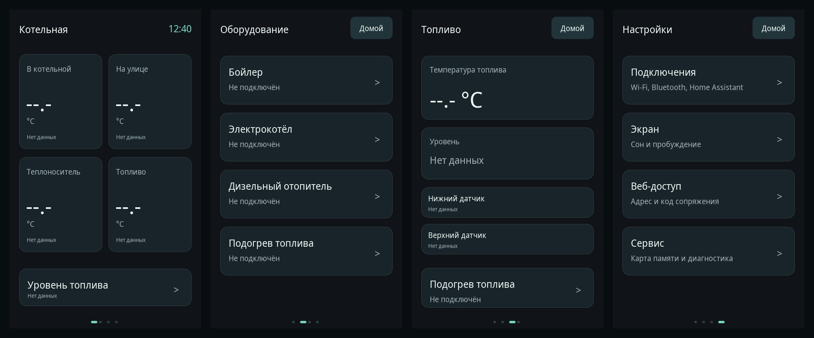
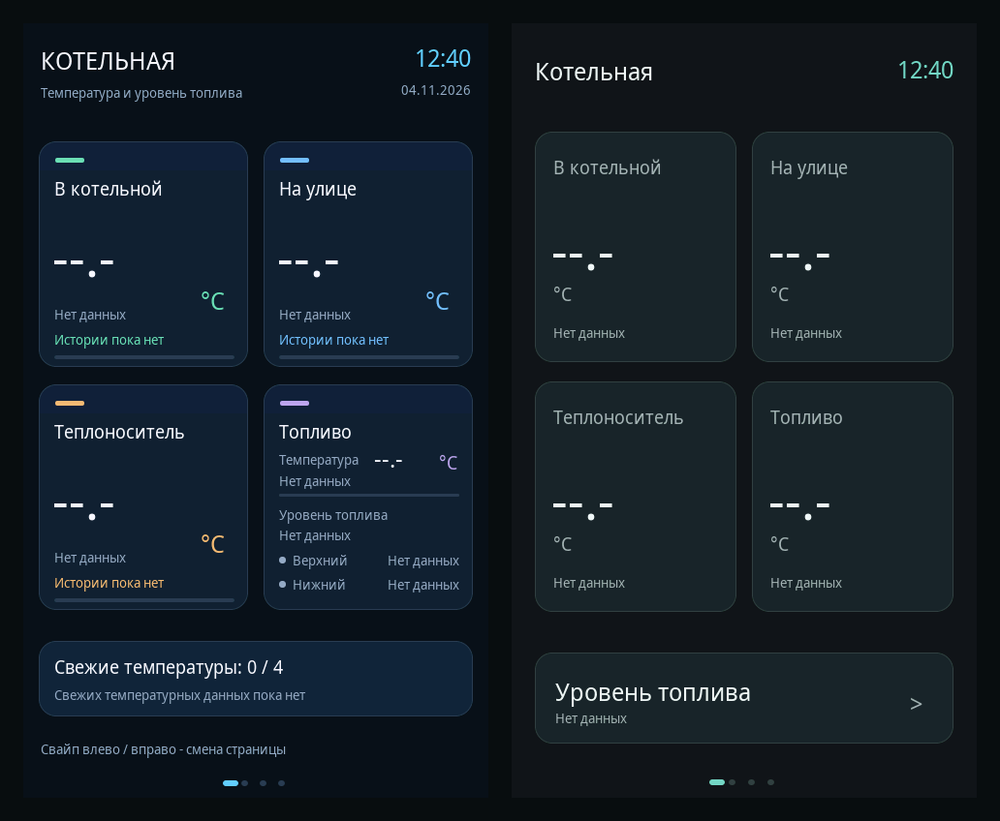

# Новое меню физической панели — v0.8.0, вариант для просмотра

**Не установлено на устройство.** Изменения относятся к сенсорному дисплею GUITION JC4880P443 (480×800, LVGL 8.3.11), не к веб-панели. Основа — ветка Home Assistant v0.7.0. По предыдущей аппаратной проверке на панели установлена v0.7.0; адрес после подключения Wi-Fi был `192.168.144.207`. В этой работе COM3 не открывался, прошивка/настройки панели не менялись.

## Посмотреть

[Интерактивный просмотр](preview.html) — скачайте этот HTML-файл и откройте в браузере. Файл самодостаточный, содержит снимки LVGL и не обращается к реальной панели. На самом дисплее нижних кнопок нет; боковые кнопки в HTML служат только для просмотра проекта.

Слева прежняя структура главной, справа новая. Оба изображения получены отрисовкой кода в настоящем LVGL, не генерацией картинки. Все время, сети, адреса, сведения о карте, код сопряжения и значения в снимках — из тестовых фикстур. Они не являются показаниями устройства. Сценарии с числами, просроченными данными и подтверждением удаления явно отмечены в просмотре.

## Что изменено

- **Главная:** одинаково крупные четыре температуры и короткий переход к уровню топлива. Убраны дата, подпись «Температура и уровень топлива», тренды, полосы свежести, счётчик свежих датчиков и постоянная подсказка о свайпах. Свежесть не потеряна: отсутствующее значение остаётся `--.-`, устаревшее — с подписью «Устарело». Подробности и история открываются касанием карточки.
- **Оборудование:** четыре крупных строки, нажимается вся строка. Нет отдельной кнопки «Открыть» и повторов «нет данных о работе». Контуры электрокотла находятся внутри его экрана. Статус неподключённого контроллера показан честно; команд отопления не добавлено.
- **Топливо:** отдельная основная страница — температура, один итог уровня, два геркона и переход к подогреву. Проценты и литры не выдумываются. Противоречивый уровень остаётся предупреждением.
- **Настройки:** четыре группы — «Подключения», «Экран», «Веб-доступ», «Сервис». В подключениях находятся Wi-Fi, Bluetooth и состояние Home Assistant; MQTT настраивается через существующую веб-вкладку. В сервисе отдельно открываются microSD, диагностика и версия панели.

Свайпы циклически переключают **Главная → Оборудование → Топливо → Настройки**. На главной часы, на остальных страницах «Домой». Внутри разделов есть «Назад» с возвратом на один уровень, не всегда в корень. На нижнем крае только пассивные точки.

## Визуальные решения

Один спокойный акцент вместо четырёх цветовых схем: фон `#101719`, карточки `#1B2528`, основной текст `#EFF5F3`, вторичный `#A1B3B5`, акцент `#76D6C3`. Красный и янтарный используются для опасного действия или предупреждения, а не для каждого неподключённого прибора. Существующие шрифты панели сохранены: крупные значения 55 px, заголовки 25 px, обычный текст 19 px, подписи 14 px. Новые внешние шрифты не добавлены.

## Плагины и навыки

Проверен доступный каталог: есть Figma и навыки создания экранов/дизайн-систем, Designer для веб-макетов, GitHub и Desktop Commander. Отдельного установленного навыка LVGL в каталоге не найдено. Designer изучен, но веб-макет не выбран в качестве доказательства работы прошивки; Figma-файл в этой задаче не создавался. Для реализации использованы GitHub, Desktop Commander, настоящий LVGL и проверки на целевой сборке. Это позволяет оценивать именно те шрифты и координаты, которые попадут на дисплей.

## Сохранённые ограничения

Wi-Fi/C6, MQTT, драйверы датчиков, NVS, веб-API, защита сопряжения и SD-драйвер функционально не менялись. Изменены экранные компоненты, маршруты и версия приложения. Команды отключения Wi-Fi и удаления сети перенесены в «Другие действия» и теперь требуют подтверждения. Если команда отвергнута очередью радио, диалог показывает ошибку, а не закрывается как при успехе.

Форматирование microSD по-прежнему возможно только после защищённого веб-запроса и отдельного физического подтверждения; кнопки скрыты без ожидающего запроса. Не выполняются полное стирание Flash, прошивка C6, смена сети или назначение GPIO. Первая отрисовка по-прежнему происходит до инициализации тача; первое касание после сна только будит экран.

## Проверки

`tests/calm_ui/host.cpp` компилирует фактический `src/main.cpp` с настоящим LVGL и изолированными заменами аппаратных подсистем. Он проверяет реальные события указателя: свайпы, навигацию, возврат, подтверждение/отказ сетевой команды, выбор сети во время обновления списка, код сопряжения, скрытие и физическое подтверждение SD, сон/пробуждение, отсутствие/устаревание температур. Также выполняются 240 перестроений страниц и проверка границ подписей. Модель устройства в тесте не имеет доступа к COM3, сети, GPIO или NVS.

Отдельный workflow `Calm physical menu` воспроизводит нативные тесты и снимки. Старый общий CI имеет независимую проблему #15; новый workflow не скрывает её. Сборка ESP32-P4 проверяется отдельно. Не проверены физические ощущения от касаний, читаемость конкретного дисплея и работа новой прошивки на устройстве: это следующий этап только после оценки пользователем и отдельного запроса на установку.

Документация LVGL: [события 8.3](https://lvgl.io/docs/open/8.3/overview/event.html), [исходники закреплённой версии](https://github.com/lvgl/lvgl/tree/74d0a816a440eea53e030c4f1af842a94f7ce3d3).
