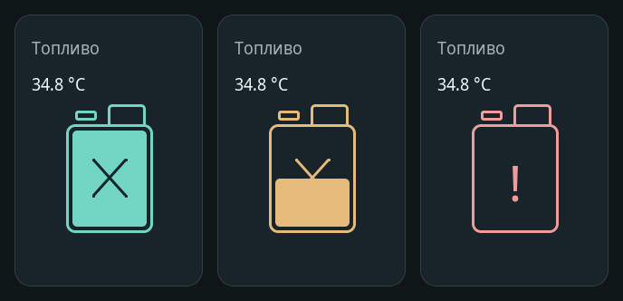

# Канистра внутри карточки «Топливо» — v0.8.1

**Подготовлено в исходниках, не установлено на панель.** На физическом устройстве остаётся v0.8.0. Ветка `feature/fuel-canister-card-v0.8.1` создана поверх `feature/calm-panel-menu-v0.8.0` (установленный код `b8dc226b9a07c6b7b4ec4f58bd338ee8219d7f1f`). COM3 не открывался, настройки и GPIO не менялись.

Слева направо: оба контакта разомкнуты; замкнут только верхний; замкнуты оба. Температура 34,8 °C на снимках — тестовая. Изображения получены реальным LVGL из изменённого кода, не с подключённой панели.

## Главная страница

Канистра находится **внутри правой нижней карточки «Топливо»**. Над значком — температура топлива шрифтом 19 px вместо прежних крупных цифр; другие температуры остаются крупными (55 px). Нижняя кнопка «Уровень топлива» полностью удалена, четыре карточки занимают освободившееся место. Нажатие на карточку или сам значок открывает страницу «Топливо», где остаются подробности и история температуры. Свайпы, часы и «Домой» сохранены.

[Просмотр шести состояний без подключения к устройству](preview.html) — скачать HTML и открыть локально. [Вся главная](home-full.png).

## Таблица физических контактов

| Верхний геркон | Нижний геркон | Значок |
|---|---|---|
| Разомкнут | Разомкнут | Полная канистра |
| Замкнут | Разомкнут | Полканистры |
| Замкнут | Замкнут | Пустая канистра, красный `!` внутри |
| Разомкнут | Замкнут | `?`, «Ошибка уровня»; не выдаётся за пустую/полную |
| Нет данных хотя бы одного входа | — | Серый `?`, «Нет уровня» |
| Один/оба отсчёта устарели | — | `?`, «Устарело» |

Полканистры — заданная пользователем условная ступень уровня по герконам, **не измерение 50% объёма и не количество литров**. Неизвестный или просроченный уровень не становится полной канистрой; температура независимо может оставаться действительной. Недействительная температура отображается `--.- °C`; настоящий 0 °C не скрывается.

### Полярность и существующий драйвер

В проекте модель, веб-API и HA используют `reached` — «топливо достигло высоты датчика», а не «контакт замкнут». Для заданного пользователем поведения **оба входа настраиваются в существующий режим «Геркон NC» (Type 3)**: разомкнутый сухой контакт = HIGH = `reached=true`. Тогда таблица выше получается без противоположных показаний в вебе/HA. Режим NO (замкнут = достигнут) сохранён для иных датчиков и **не подходит для этой схемы**.

В `panel_config::reedLevelReached()` вынесено прежнее выражение нормализации без изменения его поведения; эту же функцию вызывает реальный сенсорный драйвер и тесты. Автоматического изменения NVS, переключения типа или назначения GPIO нет. При будущей настройке двух входов выбрать NC и проверить реальные контакты. Отсутствие назначений остаётся «нет данных», а не «оба разомкнуты».

Двухпроводные несупервизируемые герконы **не отличают обрыв провода от разомкнутого контакта**. Такая индикация не может быть единственной аппаратной защитой подачи/подогрева топлива. Новых команд нагревателям, насосам и реле нет.

## Проверено

Нативный тест `tests/calm_ui/host.cpp` использует настоящий LVGL, настоящую функцию нормализации NO/NC и очередь событий датчиков. Проверены все четыре комбинации физических контактов, отсутствие одного/обоих отсчётов, старение данных, нулевая/отрицательная/недействительная температура, размеры/заполнение/символы канистры, отсутствие нижней кнопки, кликабельность через пассивные дочерние элементы и сохранение свайпов/возврата/защит. **347 проверок расположения, 0 обрезанных надписей**, включая прежние 240 перестроений экранов. Аппаратные подсистемы изолированы тестовыми заменами; настоящий GPIO/геркон не проверялся.

Отдельные статические проверки датчиков, конфигурации, веба, microSD и JavaScript Home Assistant выполняются; сборка P4 и GitHub Actions фиксируются в комментарии PR. Старый общий CI #15 этой задачей не исправляется.

После каждого перестроения экрана указатели канистры сбрасываются вместе с другими виджетами. Массивы координат линий имеют статический срок жизни. Нет файлов изображений в прошивке и новых шрифтов: знак строится штатными объектами LVGL.
