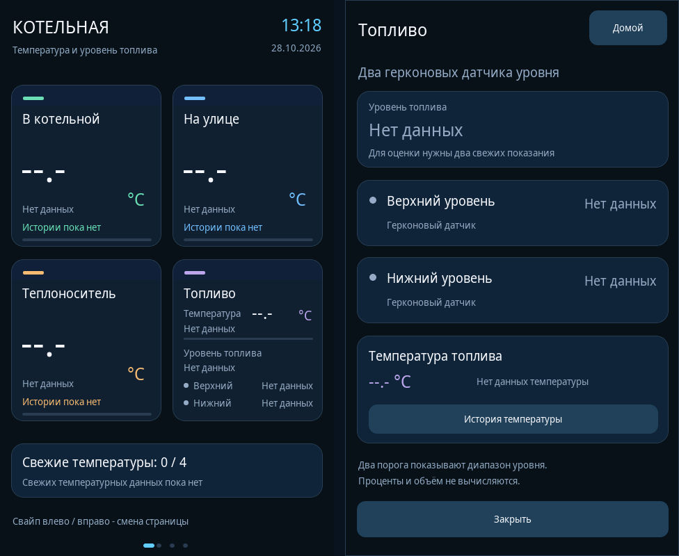

# Топливо: температура и два герконовых датчика уровня

В карточку «Топливо» добавлены верхний и нижний уровни. Температура топлива
сохранена. Нажатие на карточку открывает отдельный экран с обоими датчиками,
общим состоянием уровня, температурой и переходом к её истории.



Это рендер исходников с настоящим LVGL 8.3.11, размер каждого экрана 480×800.
Показаний датчиков по умолчанию нет. Реальная плата и датчики этим изображением
не проверяются.

## Показания уровня

Для итогового состояния нужны **два известных свежих показания**. «Достигнут»
означает, что уровень топлива достиг высоты соответствующего датчика после
нормализации входного сигнала.

| Нижний уровень | Верхний уровень | Текст на экране |
|---|---|---|
| Не достигнут | Не достигнут | Ниже нижнего |
| Достигнут | Не достигнут | Между датчиками |
| Достигнут | Достигнут | Верхний достигнут |
| Не достигнут | Достигнут | Проверьте датчики |

Если хотя бы один вход неизвестен, общий статус — «Нет данных». Если оба входа
известны, но хотя бы один устарел, общий статус — «Данные устарели». Отдельные
строки сохраняют собственные состояния: свежий датчик не помечается устаревшим
из-за второго датчика. Устаревший или неизвестный сигнал не подменяется
значением «Не достигнут».

Два порога показывают диапазон уровня. Они не задают точный процент, объём,
состояния «Пустой» или «Полный». Узкая полоса в температурной части карточки
по-прежнему относится только к свежести температуры.

## Что реализовано

- `FuelLevel` и `ReedLevelReading` в `src/panel_types.h` описывают данные и
  дискретное итоговое состояние. Срок свежести — существующий `STALE_MS`,
  30 секунд; используются устойчивые к переполнению `millis()` разности.
- `src/main.cpp` отображает оба порога в карточке и на отдельном экране.
  Обновление уровня не зависит от наличия или изменения температуры.
- Сохранены температура, история температуры, «Назад к топливу», «Домой»
  и навигация свайпами. Сводка на главной явно относится к температуре.
- Установщик распознаёт точный исходный набор `b700ef6` как `v04_before_fuel`.
  Обновление меняет только `main.cpp` и `panel_types.h`; INI и существующий
  совместимый адаптер экрана сохраняются. Неизвестные и смешанные наборы
  по-прежнему отклоняются.

## Контракт будущего аппаратного подключения

Модель принимает **нормализованные устойчивые состояния**, а не непосредственный
уровень GPIO или факт замыкания контакта. Пример вызова будущего адаптера:

```cpp
// ВАЖНО: порядок аргументов — нижний, затем верхний.
fuelLevel.put(lowerReached, upperReached, now);
```

`true` означает «уровень достигнут», `false` — «уровень ниже этого порога».
Если датчик не прочитан или его показанию нельзя доверять, его reading нужно
оставить неизвестным либо вызвать `clear()`. Показание со значением `false`
является известным результатом, поэтому им нельзя обозначать отсутствие данных.

На этом этапе GPIO, NO/NC, электрическая полярность, питание и подавление
дребезга не выбраны. Преобразование фактических состояний конкретного герконового
датчика в этот контракт выполняет будущий аппаратный адаптер. Значения должны
периодически подтверждаться даже при неизменном уровне, чтобы не истекал срок
свежести. Передача данных из другой задачи потребует согласованного снимка и
синхронизации с UI; сам контейнер `FuelLevel` не является потокобезопасным API.

По умолчанию оба входа неизвестны. Чтения физических датчиков, назначения GPIO,
управления насосами, клапанами или автоматического заполнения в этом изменении
нет. Ранее найденные несвязанные замечания аудита остаются отдельными задачами.

## Проверка

Штатный `tests/model_tests.cpp` дополнен комбинациями обоих порогов, частичными
показаниями, точной границей устаревания, восстановлением и переполнением
таймера. `tests/host/host.cpp` проверяет настоящий LVGL: открытие карточки
касанием, все состояния, обновление без температуры, сохранение окна,
устаревание одного входа, историю и возврат, размер шрифта и границы текста.
Тестовые значения существуют только в host-fixtures; production не подставляет
демонстрационные показания.

`tests/updater_tests.py` дополнен переходом с `b700ef6`, идемпотентностью,
точным откатом и отказом при смешанных/неизвестных исходниках или неверном glue.
Результат сборки нужно смотреть для конкретного коммита в GitHub Actions;
успешная компиляция не является проверкой физической схемы герконов.

## Согласованное развитие визуализации

[Макет предупреждений, журнала и диагностики](monitoring-preview/README.md)
показывает согласованный пользователем следующий вариант интерфейса. Он
содержит демонстрационные состояния и не является рендером новых функций
прошивки. Фактически реализованный интерфейс описан выше.

По уточнению пользователя в макет добавлен подогрев топлива **до 80 °C**.
Фактическая температура и состояние подогрева остаются неизвестными. Рабочий
режим, аварийный предел и алгоритм регулирования этим макетом не задаются.

В визуализацию также добавлены кнопки «Включить» / «Выключить» подогрев и
демонстрации доступного и недоступного управления. Это проект интерфейса
запросов к будущему контроллеру; команды оборудованию в прошивке не реализованы.
