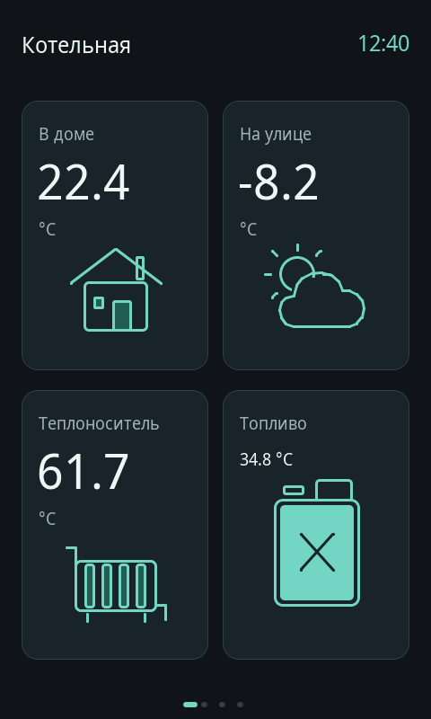
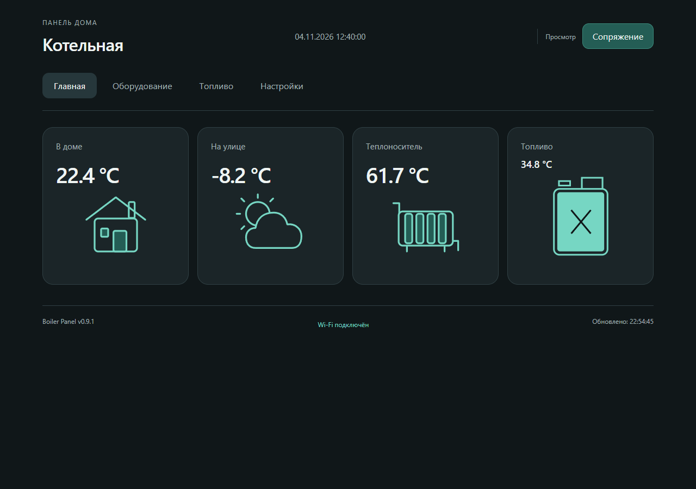

# Главная: температура в доме и контурные значки — v0.9.1

**Кандидат, не установлен.** На панели остаётся v0.9.0. Этот этап не обращался к COM3, не прошивал устройство, не менял Wi-Fi/MQTT, GPIO, полярность герконов или сохранённую конфигурацию.

Это реальная отрисовка `src/main.cpp` в LVGL 8.3.11, не фотография устройства. Часы и показания — явно синтетические данные тестового стенда. [Без подключённых датчиков](panel-no-data.png) · [Код сопряжения, тестовый](panel-pairing-fixture.png).

## Изменения по запросу

«В котельной» заменено на **«В доме»** в основной карточке, истории температуры, веб-форме назначения датчика и имени сущности Home Assistant. Название всего проекта «Котельная» сохранено. Канал 0, ключ MQTT `room`, unique_id и GPIO остались прежними; исторические отчёты и фиксированные эталоны старых версий не переписывались.

На главной появились три подходящие контурные пиктограммы: дом для домашней температуры, солнце с облаком для уличной и радиатор для теплоносителя. Толщина линий, цвет и характер рисунка согласованы с канистрой. Крупный размер остальных температур 55 px сохранён; температура топлива остаётся 19 px над канистрой. Отдельной нижней кнопки уровня по-прежнему нет.

**Солнце с облаком — символ уличного датчика, не прогноз. Радиатор — символ теплоносителя, не индикация включения.** Реальные отсутствующие/устаревшие значения не заменяются тестовыми. Детали значков не перехватывают касания: нажатие по рисунку открывает ту же историю, что и по карточке.

## Веб-панель

[Мобильный вид](mobile-home.png). Рисунки — встроенный SVG, без CDN, запросов к внешним картинкам и новых шрифтов. На дисплее — геометрия LVGL. Не добавлены настройки или новые сетевые команды.

## Проверки

- Настоящий LVGL: **350 проверок размещения, clipped=0**, нажатия по каждому значку, геометрия декоративных элементов, отсутствие перекрытий с цифрами/единицами/статусом, значения −55/0/125 °C, неизвестные и устаревшие данные, прежние свайпы, сопряжение и защитные действия.
- Chromium: 320/390/768/1280 px, переходы в историю по каждому рисунку, новая подпись и прежний цикл сопряжения/канистры/настроек; без ошибок страницы и без записи настроек.
- Тест MQTT отдельно сохраняет ключ `room` и проверяет новое имя. Версия согласована в `VERSION`, `panel_types.h`, README и CHANGELOG.
- Целевая сборка и актуальные CI приводятся в PR/отчёте отдельно. Успех native/браузерных тестов не выдаётся за аппаратное испытание. Старый общий CI Issue #15 не изменялся этой задачей.

Для следующей установки использовать эту версию только после проверенной target-сборки и отдельного запроса. Следовать `docs/RELEASE_PROCESS_RU.md`; не оставлять после установки старые main/тег/Release.

## Целевая сборка

Исходники `db7d221b7c89990e2ef12ffc27552c9c35422945`, PlatformIO `jc4880p4`, PIOArduino 55.03.36-1 / Arduino-ESP32 3.3.6: **SUCCESS**. Исходники каталога target-сборки сравнены с коммитом. RAM 45 460 байт, program Flash 1 738 374 байта. `firmware.bin`: 1786096 байт, SHA-256 `3bcc8663c088255763e75c3d42fdc00f8920332fa9785797904199653cdaf80b`. Локальный пакет `BoilerPanel-v0.9.1-COM3.zip`, SHA-256 `15db67fa865a734b60130dc4076724d7212c50e55f09b678a6ef6bfd064bb6f2`. Пакет остаётся на Asus; это не установленный и не опубликованный стабильный релиз. Новый код — [PR #20](https://github.com/DeadSoulf/boiler_room/pull/20).
