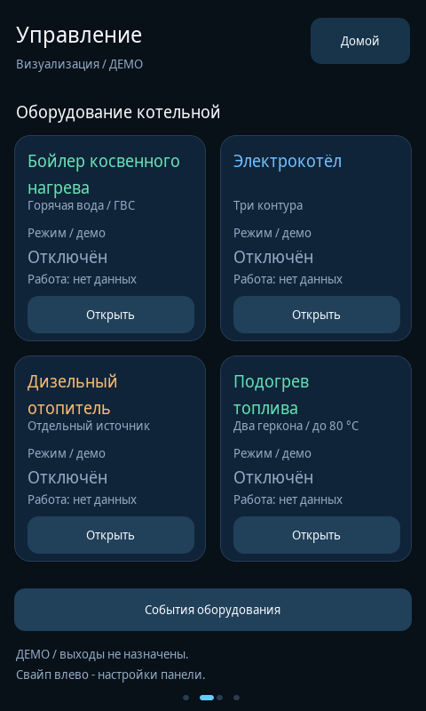

# Нативная визуализация v0.5.0

Пользователь попросил загрузить визуализацию на GUITION JC4880P443 через COM3.
Исходная версия GitHub: `e09980a21f55565d1c0ba5174eeb35be96143997`.
Подготовлены экраны оборудования, локальная демо-модель, миграция исходников
и отдельный загрузчик приложения. Веб-версия v0.3 не изменялась.

## Проверка до target-сборки

| Область | Результат |
|---|---|
| Модель уровней, температур и навигации | 40 054 assertions |
| Новая локальная модель 7 узлов | 540 assertions; GCC C++17 и ASan/UBSan |
| Установщик исходников | 51 тест, включая точную v0.4, повтор и восстановление нового header |
| Локальный загрузчик COM3 | 17 offline-тестов с имитацией Flash |
| Упаковка лицензий и манифест | 2 теста |
| Настоящий LVGL 8.3.11 | Старый и новый harness, 240 пересозданий страниц, обрезанных подписей 0 |
| Шрифты | 153 использованные кодовые точки покрыты шрифтами 14/19/25/55 |

Независимый проверяющий добавил сценарии настоящих pointer events: четыре
карточки, возврат и «Домой», свайпы, вертикальная прокрутка контуров,
подтверждение/отказ/таймаут, замена ожидающего ON на OFF, сброс ожидающего
запроса, независимость контуров и общий котёл, предупреждение на четырёх
основных страницах, журнал 16 событий. Счётчик радио `submit()` во всех
сценариях оборудования остался 0; измерения и герконы не заполнялись.

При проверке загрузчика исправлен отказ восстановления после повреждения
текущего заголовка приложения. Теперь проверяется сохранённый образ,
повреждённое текущее приложение архивируется и не мешает восстановлению.
Регрессионный тест включён. API проверен по esptool v5.1.0, OTA — ESP-IDF v5.5.2.

Локально CMake был недоступен: тот же host target собран напрямую GCC/G++
из 193 C-файлов LVGL/шрифтов и проектных C++ с теми же include и конфигурацией.
LeakSanitizer среды недоступен; ASan/UBSan запущены с `detect_leaks=0`.
GitHub Actions выполняет штатную CMake-проверку и target-сборку отдельно.

## Снимки настоящего LVGL

Это точные растровые кадры 480×800 из host-теста, преобразованные PPM → PNG.
Они не являются фотографиями физического дисплея.

- [Бойлер](equipment_dhw_native.png)
- [Электрокотёл](equipment_electric_native.png)
- [Прокрутка трёх контуров](equipment_three_circuits_native.png)
- [Дизельный отопитель](equipment_diesel_native.png)
- [Подогрев топлива](equipment_fuel_native.png)
- [Отказ выключения](equipment_rejected_off_native.png)
- [Заполненный журнал](equipment_journal_full_native.png)

## Доказательства и границы

Версии файлов: [verified-files.json](verified-files.json).
Полные журналы: [host-ui.txt](host-ui.txt), [updater-tests.txt](updater-tests.txt).
Следующий этап и фактический итог target-сборки фиксируются в
[PR №2](https://github.com/DeadSoulf/boiler_room/pull/2) по точному коммиту.

Прямые команды Desktop Commander были остановлены сервисом из-за месячной
квоты. В доступном Linux-окружении последовательных портов не было.
**Запись COM3 и физический экран этим отчётом не подтверждаются.**
Windows `.cmd` и реальный USB требуют испытания на компьютере пользователя.
Пакет прекращает запись при неподтверждённой ревизии, разметке, загрузчике,
защите, OTA или резервной копии; обход этих проверок не добавлялся.
