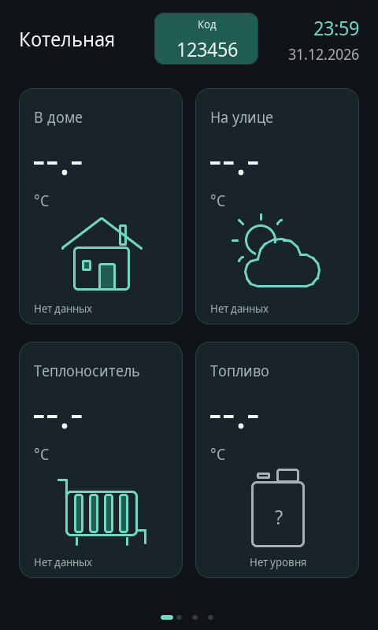

# v0.10.4 — дата под часами на главной панели

## Запрос и результат

Пользователь попросил добавить дату там, где показано время, не мешая отображению пароля. На физической панели это шестизначный код сопряжения браузера. Дата **ДД.ММ.ГГГГ** помещена под часами в прежней правой области шапки; положение и размер кода не изменены. На остальных страницах сохраняется кнопка «Домой».

Обе строки получают один `time(nullptr)` и один результат `localtime_r`, поэтому используют действующий часовой пояс панели и согласованно переходят на следующий день. Пока часы не установлены, показаны `--:--` и `--.--.----`. Неизменные строки повторно не отправляются на перерисовку. Настройки времени, код сопряжения и механизм OTA не изменялись.

## Проверенная локальная версия

Основа — GitHub main `9e09b60c9d813968e6923dd9b06f7ee4699cb565`, включающий опубликованную v0.10.3. Прикладная правка ограничена `updateClock()` и шапкой Home в `src/main.cpp`; отдельно расширен существующий native-стенд.

| Файл | SHA-256 |
|---|---|
| `src/main.cpp` | `abfd67004316a81f60e2e3e7d51a62928d79c751b57ff5b30fcc1864a411ca27` |
| `tests/calm_ui/host.cpp` | `e0c06f01377c702880e64fce483cc9153aad00e4a7711ba0d2121d3ff8dd175f` |
| Неизменённый `tests/calm_ui/fakes.h` | `31f9c02f3f8d888a3655689f6d37e1c07318821a38446294dd798a6df950803a` |

## Настоящий LVGL и независимая проверка

Исполнитель и отдельный проверяющий каждый пересобрали и запустили окончательные исходники с настоящим LVGL 8.3.11 (`74d0a816a440eea53e030c4f1af842a94f7ce3d3`). В частичном режиме и `full-refresh` с двумя полными буферами получены **408 layout checks, clipped=0**, exit 0. Сборка проверяющего — без предупреждений и ошибок.

| Элемент | Границы в пикселях | Проверка |
|---|---|---|
| Часы font25 | `(334,18)…(455,52)` | Все 1440 вариантов HH:MM имеют ширину не более 58 px при доступных 122 px |
| Дата font19 | `(334,55)…(455,81)` | Текст занимает 90 px, одна строка, ниже часов |
| Код сопряжения | `(196,16)…(327,81)` | Прежний блок, цифры font25; не пересекается с правой областью |

Проверены неизвестное время и восстановление, граница допустимого времени, полночь 31.12.2026 → 01.01.2027, смена часового пояса с переходом на другой день, сохранение активного кода при обновлении времени, успешное сопряжение и истечение кода, навигация настоящими pointer events. Просмотрены реальные кадры LVGL с кодом, без кода и с неизвестным временем. Значение `123456` в тестовом кадре — искусственная fixture, не код устройства.

Двадцать одинаковых вызовов обновления времени дают **0 кадров** и неизменные пиксели. Сохранены регрессии v0.10.3: неизменный OTA snapshot и 22 изменения radio дают 0 кадров/удалений; 20 изменений реального прогресса дают 20 кадров. Крупный одинаковый размер четырёх температур также проверен.

Логи независимой проверки: [partial](v0.10.4-home-date-native-partial.log), [full-refresh](v0.10.4-home-date-native-full-refresh.log). Проверка согласованности VERSION, firmware constant, README и CHANGELOG успешна.

## Выпуск и проверка файлов

[v0.10.4](https://github.com/DeadSoulf/boiler_room/releases/tag/v0.10.4), ID 435037523, опубликована 2026-11-05T10:09:53Z; source/tag `e14a3bb6a0d92d9592b3b11c501743c5c9ff2ebc`, [PR #25](https://github.com/DeadSoulf/boiler_room/pull/25) объединён через `323c4c5557a6f3d6f9deeb5dbcd31d7024d756a6`. [Release workflow 42007522847](https://github.com/DeadSoulf/boiler_room/actions/runs/42007522847) — SUCCESS.

Финальный release-run заново выполнил native partial/full-refresh (408/0 в каждом), OTA policy/runtime/release, браузерные сценарии и сборку ESP32-P4. Веб-проверки прошли на ширинах 320/390/768/1280; тестовые серверы не обращались к панели. Общий старый host CI отдельно повторил известный `esp_wifi.h` ([run](https://github.com/DeadSoulf/boiler_room/actions/runs/42006504164), [issue #15](https://github.com/DeadSoulf/boiler_room/issues/15)); этот сбой не исправлялся и не называется успешным CI.

| Файл Release | Байты | SHA-256 |
|---|---:|---|
| `boiler-panel-ota.json` | 609 | `c9daa4684eea084992f074e609a8a237914f4e27e02ca10a02ccda80a7b058d1` |
| `BoilerPanel-v0.10.4-COM3.zip` | 1099736 | `1646449bab09e1cc8b1f5b08b075bf88daf55f9fcb1fa47dddeea6dd0b73d627` |
| `BoilerPanel-v0.10.4-firmware.bin` | 1943792 | `dbbec15578d6ea2e0816f11969cc625cd9d5c03457ae1d36f80201832f16ee5f` |
| `SHA256SUMS.txt` | 282 | `a107fd010ebcb85fd0efc96f03a0114479dbc70611cbae2d9e0920d5f19cd24a` |

Шаг повторного скачивания всех четырёх публичных assets **без аутентификации**: 2026-11-05T10:09:54Z — 2026-11-05T10:09:56Z, SUCCESS. Поле `verified_at_utc` в сыром отчёте записано в начале этой проверки, а не после последнего скачивания.

Root повторно скачал артефакты именно этого release-run и сверил SHA-256 архивов с GitHub. Проверены реальные build/browser/native logs, их связь с proof, точные source inputs, API Release, публичные SHA/размеры, вложенный SHA256SUMS.json, SOURCE.txt, firmware и OTA-манифест. Тег не переносился на документационные коммиты. [Машиночитаемый отчёт](v0.10.4-home-date-2026-11-05.json).

## Проверочный кадр

Ниже настоящий framebuffer LVGL 480×800 с искусственными датой, временем, PIN и отсутствующими показаниями. Это проверка одновременного размещения элементов, не фотография устройства.

## Установка и границы

Asus Offline на проверке **2026-11-05T10:10:24Z**; текущая версия панели неизвестна. Последняя принятая по сети установленная версия остаётся **v0.10.1**. Установка v0.10.4 и физическая приёмка не подтверждены; `installed.json` не изменён. Последний достоверный HTTP-снимок панели от 05.11.2026 07:59:47 UTC сообщал v0.10.1. В рамках этого выпуска USB/ROM/reset, обход PIN и форматирование microSD не применялись.

Следующий шаг — штатная установка **v0.10.4** через **Настройки → Сервис → Обновление → Проверить**, с подтверждением конкретной версии на панели или в сопряжённом браузере. Выпуск включает предыдущие исправления; промежуточная установка v0.10.3 не нужна. Затем проверить фактическую новую версию, подтверждение загрузки, HTTP/HTML, службы, сохранность настроек и доступную предыдущую версию. Только после приёмки обновлять `installed.json`.

Скачивание новой версии рисует установленная до перезагрузки прошивка; дата и включённое исправление перерисовки начинают работать после запуска новой версии. Native-рендер и target-сборка не подтверждают физическую картинку LCD, отсутствие аппаратного мерцания или завершение установки.
