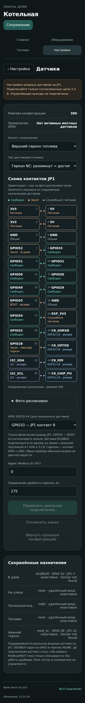
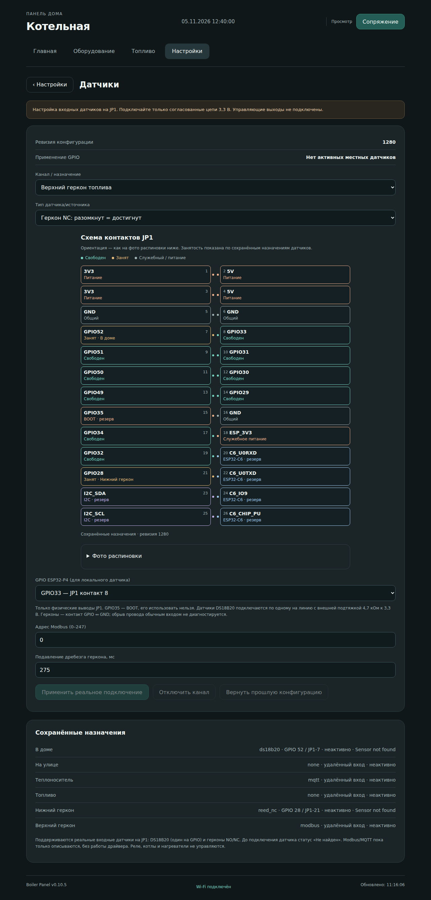

# v0.10.5 — схема JP1 в веб-настройках датчиков

## Запрос и изменение

Пользователь предоставил фотографию контактов платы, затем уточнил: «Сделай Это схематично как на этом примере при занятии пина сделай чтоб было обозначение что он занят». В **Настройки → Датчики**, возле выбора GPIO, добавлена схема 13 рядов по два контакта, с нумерацией 1–26. Разрешённые GPIO показывают «Свободен» или «Занят» и название канала по сохранённой конфигурации. Существующие назначения датчиков, список доступных GPIO и пояснение о GPIO35/BOOT сохраняются. Провода для прошивки C6 из визуального примера к этой задаче не относятся и не переносятся.

Занятость не зависит от того, отвечает ли датчик сейчас, и не берётся из несохранённых полей формы. `connections.available` явно сообщает, получен ли снимок конфигурации; при недоступном/неполном состоянии или потере связи UI не объявляет GPIO свободными. Питание, GND, BOOT, C6 и I2C имеют статические обозначения. Фото исходной распиновки доступно отдельно под схемой.

Исходное изображение не перекодируется, не перерисовывается и не размечается заново. Это предоставленный пользователем справочный материал, а не результат нового аппаратного измерения контактов. Само добавление картинки ничего не назначает и не подключает.

## Точные файлы изображения

Основа разработки — GitHub main `d4ce9a13bae71aebf43e3527b78deee0c1c4bd84`, включающий выпущенную v0.10.4.

| Файл | Роль | SHA-256 |
|---|---|---|
| `src/web_assets/jp1-pinout.jpg` | Неизменённый JPEG 800×800, 114 530 байт | `bbd8c4af43121d48d94854e91782a15e6a59227a6c49be709562fe2a90ca8b38` |
| `src/panel_web_pinout.h` | Тот же JPEG в `const uint8_t[] PROGMEM` | `e3fa46ad54c7c475352d187ada9416bbe8b92bb464d6580dab663909025861f2` |
| `scripts/embed_pinout.py` | Воспроизводимое встраивание и проверка `--check` | `5927a51c1070bc0fcc95814e4c47c27a6544fec35b702302a5aa7515bc51daa3` |

Сервер отдаёт **GET `/assets/jp1-pinout.jpg`** с типом `image/jpeg` и явной длиной массива через существующий `WebServer.send_P`. Заголовок подключён только при включённом веб-сервере. Фото находится в Flash прошивки, живая схема — в существующей встроенной веб-странице; Интернет, microSD и отдельная загрузка файлов на устройство не нужны. Существующие HTTP-заголовки и авторизация команд не меняются.

## Выполненная проверка ресурса

- `python3 scripts/embed_pinout.py --check` подтверждает точное соответствие заголовка исходному JPEG.
- Строгая C++-компиляция настоящего заголовка и `static_assert` подтверждают 114 530 байт; выгруженный из скомпилированного массива файл побайтно совпадает с пользовательским вложением.
- Отдельный проверяющий независимо декодировал C-массив и сравнил все три представления: вложение, JPEG в репозитории и ресурс в заголовке. Они совпали по длине, байтам и SHA-256.
- Backend diff ограничен include, обработчиком картинки, регистрацией GET и read-only полем `connections.available=hasConfig`. Это поле отличает недоступный снимок от действительно пустой конфигурации. Правила сохранения конфигурации, GPIO, сопряжение и управляющие команды не менялись.

## Проверки интерфейса и выпуска

[v0.10.5](https://github.com/DeadSoulf/boiler_room/releases/tag/v0.10.5), ID 435108231, опубликована 05.11.2026 14:20:44 МСК (11:20:44 UTC); source/tag `a89a75973c55faa5dc0b707e0afbabedbb8e5bed`, [PR #26](https://github.com/DeadSoulf/boiler_room/pull/26) объединён через `374f85b3c7e6550f8ec7417b1091fa77a56d132f`. [Release workflow 42017195072](https://github.com/DeadSoulf/boiler_room/actions/runs/42017195072) — SUCCESS.

Схема JP1 содержит 13 рядов и все 26 контактов; 11 разрешённых GPIO показывают «Свободен» либо «Занят» с названием канала по сохранённому снимку назначений. Не отвечающий DS18B20 или геркон сохраняет занятый GPIO; `none`, `modbus`, `mqtt` его не занимают. Несохранённый выбор формы не считается назначением. `connections.available` сообщает о доступности снимка конфигурации, а не о presence/online датчика. При неизвестных, неполных или недостоверных данных и при потере связи GPIO не объявляются свободными; назначение одного GPIO нескольким каналам обозначено как конфликт. Питание, GND, GPIO35/BOOT, C6 и I2C сохраняют постоянные роли.

Реальный браузер прошёл 13 сценариев смены состояния; геометрия схемы и фото проверена на ширинах 320/390/768/1280. Форма, фокус и открытые блоки сохраняются при опросах. Исходный JPEG 800×800, 114 530 байт, побайтно найден в target BIN ровно один раз. Финальный GitHub release-run выполнил native LVGL partial/full-refresh: по 408 проверок, 0 обрезаний. Root повторно сверил скачанные артефакты; новая независимая пересборка native вне GitHub в этой задаче не выполнялась.

Проверки включают пустые сохранённые назначения, занятый GPIO при offline датчике, переназначение и освобождение, недоступный/неполный/null снимок, ошибочный зарезервированный GPIO, конфликт двух назначений, отсутствующий блок connections, восстановление валидного снимка, HTTP-ошибку и восстановление связи. Контакт GPIO35 остаётся BOOT. Браузер не отправил управляющих или внешних запросов. Фото декодировано как 800×800; MIME и SHA-256 настоящих HTTP-ответов проверены для основной страницы и отдельной вкладки. Клавиатура/мышь открывают оригинал, а опросы не перезапрашивают изображение.

Четыре ширины относятся к основной странице, схеме и встроенной фотографии. Снимки вкладки с оригиналом сделаны в её собственном viewport 1280×900; суффикс ширины в имени такого PNG обозначает ширину исходной страницы, а не вкладки. Это изолированные браузерные сценарии с тестовыми назначениями, не реальные подключения датчиков.

Первый browser-прогон source `a4a2269912a021a7dbdb1df0fae53b475b05717c` остановился на ошибке теста `TargetClosedError`: при следующей ширине использовался ответ уже закрытой вкладки оригинала. Вторая попытка source `105a2413db5ce2a6466eb1cc0fe27a47e6d68389` выявила ранний navigation-ответ без созданного frame. В итоговом harness ответ встроенного изображения слушается только на основной странице, а ответ новой вкладки ожидается на уровне context до клика/Enter, без обращения к frame. Менялся только тест; проверки реальных байтов и все сценарии сохранены. Итоговый результат выше относится к финальному source `a89a75973c55faa5dc0b707e0afbabedbb8e5bed` и финальному release-run. Общий старый host CI с `esp_wifi.h` отслеживается отдельно в [issue #15](https://github.com/DeadSoulf/boiler_room/issues/15); эта задача его не исправляла.

`src/main.cpp` и native harness совпадают с v0.10.4 по SHA-256. Текущий release-run заново выполнил оба native режима и целевую сборку ESP32-P4. BIN содержит исходный JPEG ровно один раз, по смещению 359300; образ размером 2066448 байт помещается в разделы приложения. Это проверка собранного BIN, не считывание Flash устройства.

## Выпуск и проверка файлов

| Файл Release | Байты | SHA-256 |
|---|---:|---|
| `boiler-panel-ota.json` | 609 | `23634c9180b6d44dea92195e924a5aa08c0dbf16bbec45c6b65b55548ebea782` |
| `BoilerPanel-v0.10.5-COM3.zip` | 1212732 | `92b5c3996c0eabc7d32db74c02b23635b0607fac3e0f6fff7fa0d6d09423aded` |
| `BoilerPanel-v0.10.5-firmware.bin` | 2066448 | `f60207306ef75c8715fabf9a09a2670408a52188d15aafbf1da6ba49e2aa5d07` |
| `SHA256SUMS.txt` | 282 | `f0a85398ebf471c387ef66f8be29a098f09f7ce5a10d55cb06e6b440881f0ef6` |

Все четыре публичных файла повторно скачаны **без аутентификации** и сверены с SHA-256/размерами API Release. Шаг скачивания: `2026-11-05T11:20:44Z` — `2026-11-05T11:20:52Z`, SUCCESS. Время `verified_at_utc` сырого отчёта записывается в начале проверки, а завершение шага — после всех скачиваний.

Root сверил SHA-256 архивов артефактов финального release-run, реальные build/browser/native отчёты, source inputs, proof/preflight, OTA-манифест, SOURCE.txt и вложенный SHA256SUMS.json пакета. Тег указывает на source сборки; документационные изменения не переносят его. [Машиночитаемый отчёт](v0.10.5-sensor-pinout-2026-11-05.json).

## Проверочные кадры браузера

Это PNG из финального GitHub browser artifact с тестовыми сохранёнными назначениями. GPIO52 занят каналом «В доме», GPIO28 — нижним герконом; это не фотография панели и не свидетельство физического подключения.

## Установка и границы

Asus Offline на проверке **05.11.2026 14:21:21 МСК (11:21:21 UTC)**; текущая версия панели неизвестна. Последняя принятая по сети установленная версия остаётся **v0.10.1**. Установка v0.10.5, реальный HTTP новой версии и физическая приёмка не подтверждены; `installed.json` не изменён. Последний достоверный HTTP-снимок от 05.11.2026 10:59:47 МСК (07:59:47 UTC) исторически сообщал v0.10.1; новой HTTP-проверки в этой задаче не было. USB/ROM/reset, обход PIN и форматирование microSD не применялись.

Следующий шаг — штатная установка **v0.10.5** через **Настройки → Сервис → Обновление → Проверить**, с подтверждением конкретной версии на панели или в сопряжённом браузере. Промежуточная установка v0.10.4 не требуется. Затем проверить фактическую версию, здоровую подтверждённую загрузку, HTTP/HTML, службы, сохранность настроек и доступную предыдущую версию; отдельно осмотреть схему JP1, дату и поведение дисплея при обновлении. Только после реальной приёмки обновлять `installed.json`. USB и обход PIN не подменяют OTA.

Живая схема использует сохранённые назначения, поэтому «Занят» не доказывает физическое подключение или работоспособность датчика. Скачивание новой версии рисует установленная до перезагрузки прошивка; включённые исправления начинают работать после запуска новой версии. Browser/native/target проверки не подтверждают фактическую установку, физическую картинку LCD или отсутствие аппаратного мерцания.
