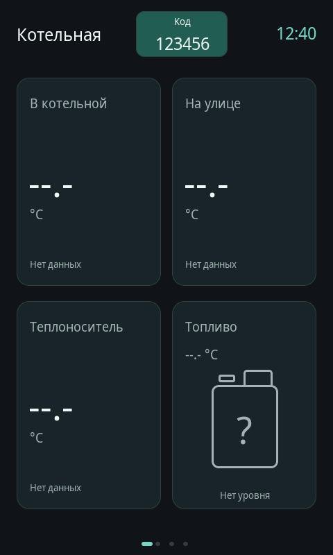
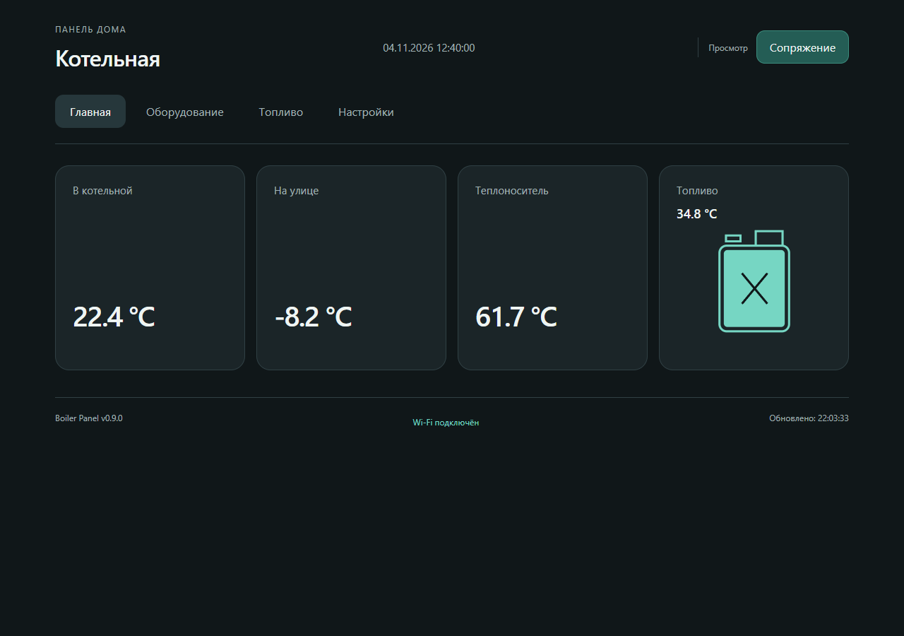
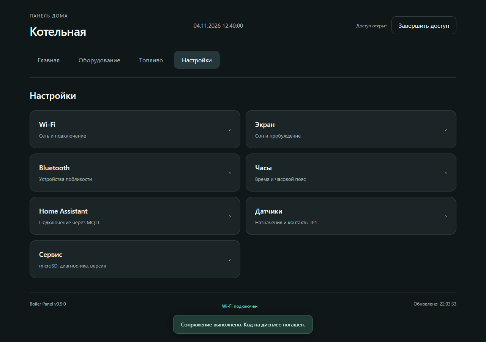
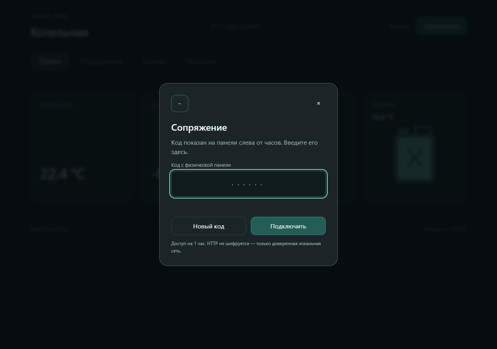

# v0.9.0 — сопряжение и веб-дизайн

## Как работает сопряжение

В браузере нажмите «Сопряжение». На физическом дисплее открывается главная страница; код появляется слева от часов. Подсветка включается на время действия кода. Введите его в браузере — при успехе код стирается, а доступ к настройкам открывается на час. При отмене запроса или через 120 секунд код также исчезает. Незавершённый диалог на панели при показе кода закрывается без отправки его команды.

На дисплее больше нет раздела «Веб-доступ». Адрес панели можно посмотреть в Wi-Fi. Завершение текущего веб-доступа — кнопкой в браузере. Новый запрос кода сам по себе не отзывает уже авторизованную сессию.

Неверный код не гасит действующий запрос до исчерпания пяти попыток. После пяти ошибок включается двухминутная задержка; генерация новых кодов дополнительно ограничена. Запрос привязан к случайному идентификатору браузера. Код не отправляется в HTTP-ответах, общедоступном status API, MQTT, логах или хранилище браузера. Предусмотрены проверка Origin и специальный заголовок; произвольная внешняя HTML-форма не может начать сопряжение.

HTTP не зашифрован: использовать только доверенную LAN. Это не замена TLS и не защита от прослушивания локального сетевого трафика.

## Новый веб-интерфейс

Четыре основных раздела, равноправные температуры, компактная температура топлива над канистрой. Нет отдельной нижней кнопки уровня. Состояния полная/половина/пустая/ошибка/нет данных/устарело согласованы с моделью панели. При потере HTTP-связи старые показания не остаются на главной как свежие.

Все формы сохранены, но находятся внутри настроек: Wi-Fi, Bluetooth, часы, экран, MQTT/Home Assistant, датчики и сервис. Три контура электрокотла вложены в карточку котла. Подробная диагностика и запрос форматирования microSD раскрываются отдельно; реальное стирание всё ещё требует физического подтверждения.

Изображения получены настоящим Chromium из встроенного `panel_web_page.h` на изолированном HTTP-стенде. Температуры, время, сведения о сети и карте на снимках **тестовые**, не показания устройства. Пример кода в нативных тестах не является паролем реальной панели.

## Проверки

`tests/pairing_tests.cpp` проверяет новую чистую C++-логику, привязку к запросу, попытки, отмену, срок и переполнение millis. `tests/pairing_static_tests.py` проверяет границы между HTTP и LVGL. Настоящий LVGL в `tests/calm_ui` проверяет размещение кода перед часами, исчезновение после успеха, пробуждение/истечение и отсутствие старого пункта меню.

`tests/web_v090_browser.py` запускает встроенную страницу в Chromium: неверный/правильный ввод, отмена, истечение, четыре состояния канистры, потеря сети, доступ ко всем настройкам, ширины 320/390/768/1280. HTTP-сервер этого теста — программная замена, не физическая панель. Все проверки без записи настроек/COM3. Результат браузера: [browser-result.json](browser-result.json).

Фактическая установка и проверки после прошивки фиксируются отдельно в `docs/verification/installed.json` и отчёте версии. Задача #15 старого общего CI не скрывается успехом новых проверок.
