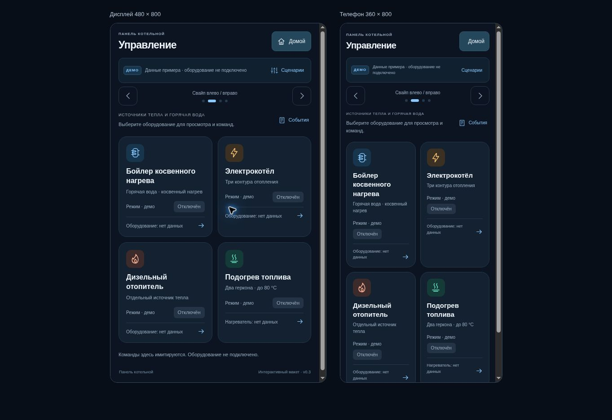

# Проверка добавления оборудования · v0.3

Дата: **29 октября 2026, МСК**. Исходная версия GitHub: `73639bdb7336dd57295d4b56ffae3dddb62158d3`, ветка `feature/fuel-level-reed-sensors`. Этот отчёт относится к добавлению оборудования в веб-панель. Сведения о сохранении и публикации после локальной проверки фиксируются в [PR #2](https://github.com/DeadSoulf/boiler_room/pull/2).

## Объём изменения

Добавлены бойлер косвенного нагрева, электрокотёл с тремя контурами и дизельный отопитель. На главной появились быстрые переходы, в «Управлении» — карточки, а внутри него — экраны `dhw`, `electric`, `diesel`, `equipment-journal`. Основных страниц осталось четыре. Сохранились четыре температуры главной, оба геркона, топливные кнопки и обозначение «до 80 °C».

Модель оборудования выделена в `dist/equipment.js`: шесть независимых демонстрационных разрешений, собственные идентификаторы запросов, ожидание/подтверждение/отказ/таймаут и отдельный журнал. Фактическая работа всегда неизвестна. Три контура пока трактуются как отопительные ветки; это обозначенное допущение, которое требует уточнения. Физические соединения, тип дизельного отопителя, источник тепла бойлера, уставки и автоматическое переключение не назначены.

Файлы прошивки, установщика и CI не менялись. Сравнение Git blob всех существовавших файлов с исходным деревом подтвердило отсутствие посторонних правок.

## Автоматические проверки

Проверены окончательные локальные исходники на Node 24.22.1. Все перечисленные команды завершились с кодом `0`.

| Команда из каталога web/boiler-panel | Результат |
|---|---|
| `node tests/model.test.mjs` | 22 теста исходной модели топлива |
| `node tests/navigation.test.mjs` | 5 тестов, включая родителей новых экранов |
| `node tests/equipment.test.mjs` | 12 тестов новой модели |
| `node tests/app-equipment.test.mjs` | 12 интеграционных тестов с inert DOM |
| `node --check dist/app.js`, `dist/equipment.js`, `dist/navigation.js`, `dist/model.js` | Синтаксис корректен |

Всего **51 тест**. Интеграционный набор включает **112 отрисовок (16 экранов × 7 сценариев)** и **84 сочетания графиков**, одновременные команды шести устройств и топлива, отказ и таймаут остановки, замену ON → OFF, поздние и повторные ответы, смену сценария/сброс, квитирование без устранения причины, маршрут предупреждения контура и синтетический свайп без случайной команды.

Полный вывод: [equipment-tests.txt](equipment-tests.txt). Независимая проверка: [equipment-review.txt](equipment-review.txt). Версии файлов: [equipment-verified-files.json](equipment-verified-files.json).

## Браузер

Проверялся Chrome на локальном предпросмотре Sites с теми же статическими файлами. Это отдельная проверка от модели и от публикации. Для целевых размеров использовались iframe с viewport **480 × 800** и **360 × 800**; временная страница проверки удалена перед упаковкой.

- Все три новые карточки и карточка топлива открываются. Четыре карточки управления на 480 × 800 заканчиваются на высоте примерно **712 px**, внутри экрана. На 360 × 800 нижний ряд требует небольшой вертикальной прокрутки.
- Все новые вложенные страницы открываются и возвращаются к «Управлению» на обоих размерах. Горизонтального переполнения и переполнения заголовков не обнаружено.
- Кнопки бойлера, электрокотла и контуров имеют высоту **48 px**, дизельного отопителя — **48–52,8 px**. Подробная страница трёх контуров прокручивается вертикально.
- В браузере запрос ON контура 1 сначала показал ожидание и прежний режим «Отключён», затем после ответа — «Разрешён». Остальные контуры остались отключёнными в демонстрации.
- Отказ OFF контура 1 сохранил «Разрешён» и отдельно показал отказ. DOM-проверка подтвердила видимость строки режима; фактическая работа осталась «Нет данных».

При независимом разборе было найдено CSS-правило, скрывавшее подтверждённый режим контура. Оно удалено до окончательной проверки. Это исправление отдельно подтверждено в браузере после отказа OFF.

Измерения: [equipment-browser-results.json](equipment-browser-results.json). Снимок:

## Границы

Быстрый жест на физическом таче и оборудование в этом этапе не испытывались. Состояния устройств и БКН 46 °C — явные примеры. Ни подтверждение команды в модели, ни проверка браузера не доказывают физический нагрев, запуск, остановку или защиту оборудования. Native-прошивка по-прежнему содержит заглушку управления; этот этап дополняет веб-панель и спецификацию.

Исторический [verification.md](verification.md) и `app-vm-review.mjs/.txt` относятся к v0.2. Они не подменяют проверку нового модуля; актуальный тест приложения находится в `tests/app-equipment.test.mjs`. Целевая сборка неизменённой прошивки отдельно для этой веб-правки локально не запускалась. Статус автоматически запущенного GitHub Actions следует проверять по конкретному коммиту PR.
